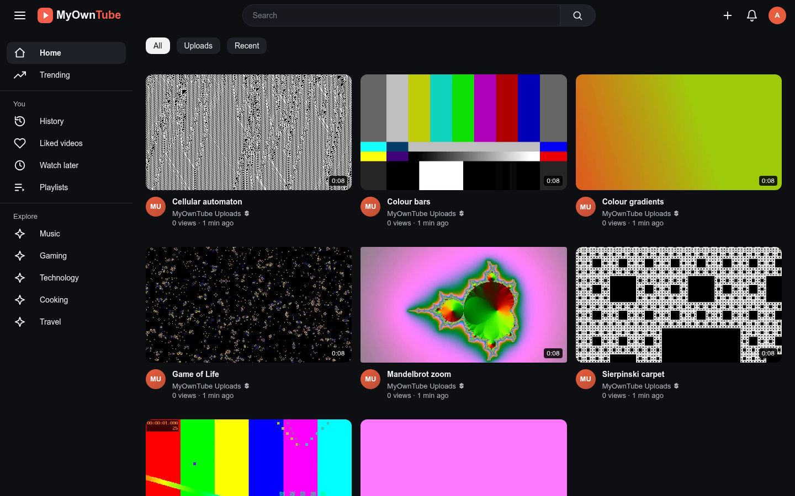

# MyOwnTube

This README is also available in:\
[en-GB](doc/README.en-GB.md), en-US, [es-AR](doc/README.es-AR.md), [es-ES](doc/README.es-ES.md)

## What is it

A private, self-hosted video library for your own Debian or Alpine Linux server.

Everyone who uses it needs an account, and each account has its own:

- Liked videos
- Watch later list
- Playback history with resume
- Playlists
- Private search suggestions
- Language (English UK/US, Spanish Spain/Argentina)

You can upload videos from the browser or import a whole folder from the server, and watch them on any device with light and dark themes.

## Screenshots



## Install

Run it as `root`.

**Debian**:

```bash
curl -fsSL https://raw.githubusercontent.com/nipegun/my-own-tube/refs/heads/main/deploy/install-update-reinstall-debian.sh | bash
```

**Alpine Linux**:

```sh
curl -fsSL https://raw.githubusercontent.com/nipegun/my-own-tube/refs/heads/main/deploy/install-update-reinstall-alpine.sh | sh
```

## Read the documentation

Explore:

- [doc/MANUAL.md](doc/MANUAL.md) to learn how to install it, update it and use it.
- [doc/CODE.md](doc/CODE.md) to understand how it is built (for developers and for AI models).

## Sponsor this project

- **[Hire me](mailto:nipegun@gmail.com?subject=I%20want%20to%20hire%20you%21)** to add new features.
- **GitHub Sponsors.** You can also support the project financially on GitHub: [github.com/sponsors/nipegun](https://github.com/sponsors/nipegun).
