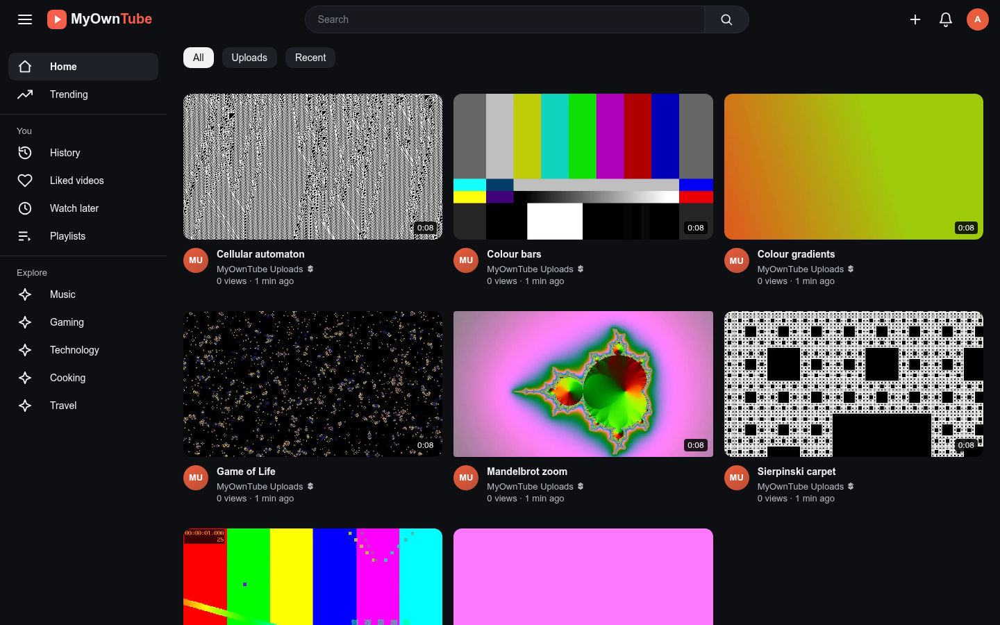

# MyOwnTube

Este README también está disponible en:\
[en-GB](README.en-GB.md), [en-US](../README.md), es-AR, [es-ES](README.es-ES.md)

## Qué es

Una videoteca privada y autoalojada para tu propio servidor Debian o Alpine Linux.

Todas las personas que la usan necesitan una cuenta, y cada cuenta tiene, de forma independiente:

- Videos que te gustan
- Lista de Ver más tarde
- Historial de reproducción con reanudación
- Listas de reproducción
- Sugerencias de búsqueda privadas
- Idioma (inglés del Reino Unido/EE. UU., español de España/Argentina)

Podés subir videos desde el navegador o importar una carpeta entera del servidor, y verlos en cualquier dispositivo con temas claro y oscuro.

## Capturas de pantalla



## Instalación

Ejecutalo como `root`.

**Debian**:

```bash
curl -fsSL https://raw.githubusercontent.com/nipegun/my-own-tube/refs/heads/main/deploy/install-update-reinstall-debian.sh | bash
```

**Alpine Linux**:

```sh
curl -fsSL https://raw.githubusercontent.com/nipegun/my-own-tube/refs/heads/main/deploy/install-update-reinstall-alpine.sh | sh
```

## Leé la documentación

Explorá:

- [MANUAL.es-AR.md](MANUAL.es-AR.md) para aprender a instalarlo, actualizarlo y usarlo.
- [CODE.es-AR.md](CODE.es-AR.md) para entender cómo está construido (para desarrolladores y para modelos de IA).

## Patrociná este proyecto

- **[Contratame](mailto:nipegun@gmail.com?subject=I%20want%20to%20hire%20you%21)** para agregar nuevas funciones.
- **GitHub Sponsors.** También podés apoyar el proyecto económicamente en GitHub: [github.com/sponsors/nipegun](https://github.com/sponsors/nipegun).
